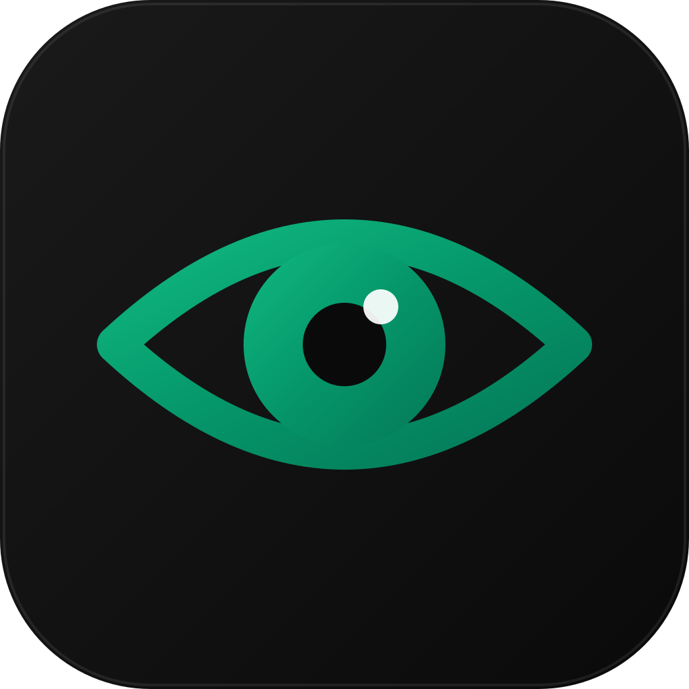

# Veghe

**Laptopul tău, de pe telefon.** Vezi de pe iPhone, de oriunde, ce face laptopul:

- **Stare**: fiecare sesiune Claude (aplicația desktop sau terminal) cu „Lucrează”, „Așteaptă aprobare” sau „Liber”, ultima unealtă folosită și ultimul mesaj. Plus bateria, aplicația din față și când ai atins ultima dată tastatura.
- **Task-uri**: trimiți o cerere de pe telefon. Intră într-o coadă și pornește doar când nicio sesiune Claude n-a mai lucrat de 3 minute (sau imediat, dacă vrei). Vezi progresul în timp real și poți continua conversația.
- **Ecran**: o captură a ecranului Mac-ului la o apăsare de buton, sau „Live” la 5 secunde. Cu **Controlează ecranul**, atingerea pe imagine face click în același loc pe Mac (sau dublu-click, click dreapta), iar de pe telefon poți și derula, scrie text și apăsa Enter, Esc sau săgețile.
- **Camere**: imaginea camerei laptopului (FaceTime HD, o cameră USB sau iPhone-ul prin Continuity), la o apăsare de buton sau „Live” la 3 secunde.
Pe Mac, aceeași aplicație are și o iconiță în bara de meniu care arată dacă vreo sesiune lucrează (⚡) sau așteaptă aprobare (✋).

## Cum e făcut

```
iPhone (web app în Safari)  ──Tailscale──▶  agent pe Mac (Node, port 8787)
                                               ├─ citește ~/.claude/projects  → starea sesiunilor
                                               ├─ rulează `claude -p`         → task-urile din coadă
                                               ├─ screencapture               → ecranul
                                               └─ cl-camera                   → camera laptopului
```

| Folder | Ce e |
|---|---|
| `agent/` | serverul de pe Mac, fără dependențe (Node 20+); în `agent/public/app` e aplicația web pentru iPhone |
| `app/` | proiectul Xcode: `ControlLaptopMac` (aplicația de Mac) și `ControlLaptop` (aplicația nativă de iPhone, opțională) |
| `scripts/` | instalare agent, hook-uri, autentificare `claude` |
| `dist/` | `ControlLaptop.ipa`, aplicația nativă de iPhone pentru Sideloadly |

## Descarcă (fără App Store)

1. Intră la **[Releases](../../releases)** și descarcă `ControlLaptop.zip`.
2. Dezarhivează și mută folderul unde vrei să rămână (ex. în `Aplicații` sau `Documente`).
3. Dublu-click pe **`Instaleaza.command`**. La prima rulare, dacă macOS blochează fișierul
   („dezvoltator neidentificat”), fă **click-dreapta → Open** o singură dată, apoi **Open**.
4. Urmează ce-ți spune installer-ul (Node.js, permisiune de ecran, login Claude, împerechere iPhone).

> Aplicația e **gratuită și open source** (licență MIT). Dacă îți e de folos, poți
> [dona](#susține-proiectul) cât vrei — nu e obligatoriu.

Ai nevoie de: un Mac (treaz, pe încărcător), **Node.js** (nodejs.org), un cont **Claude**
(pentru task-uri) și, opțional, **Tailscale** ca să-l vezi de oriunde.

## Instalare pas cu pas

### 1. Tailscale (rețeaua privată dintre Mac și iPhone)

Instalează Tailscale pe Mac (de pe tailscale.com sau din App Store) și pe iPhone (App Store) și loghează-te pe amândouă **cu același cont**. Fără Tailscale aplicația merge doar pe Mac.

### 2. Agentul pe Mac

```bash
bash scripts/install-agent.sh
```

Agentul pornește singur la fiecare login și repornește dacă se oprește. Jurnalul e în `~/Library/Logs/ControlLaptop/agent.log`.

**Captura de ecran**: prima cerere de captură face macOS să ceară permisiunea. Bifează `node` în System Settings → Privacy & Security → Screen Recording. Dacă nu apare în listă, adaugă-l cu „+” (`/usr/local/bin/node`) și rulează din nou scriptul de instalare.

**Controlul ecranului de pe telefon**: prima dată când activezi „Controlează ecranul”, macOS cere permisiunea Accessibility pentru node. Apasă **Open System Settings** și activează **node** în Privacy & Security → Accessibility. Agentul compilează singur la prima pornire programul care face click-urile (`agent/tools/cl-input.swift`), cu `swiftc` din Xcode.

### 3. Autentifică `claude` pentru task-uri (o singură dată)

Agentul folosește programul `claude` care vine cu aplicația Claude. Programul ăsta are login separat de aplicația desktop: dă dublu-click pe `scripts/login-claude.command`, scrie `/login`, autentifică-te în browser, apoi scrie `/exit`.

### 4. Hook-uri: stare exactă și aprobări de pe telefon

```bash
node scripts/install-hooks.mjs
```

Scriptul adaugă 5 hook-uri în `~/.claude/settings.json`, după ce face o copie de siguranță. Le scoți cu `node scripts/install-hooks.mjs --remove`. Se aplică sesiunilor Claude **pornite după instalare**.

- **Starea exactă** (UserPromptSubmit, Notification, Stop, SessionEnd). Fără ele, starea se deduce din transcrieri și „așteaptă aprobare” e doar o presupunere.
- **Aprobări de pe telefon** (PermissionRequest). Când o sesiune cere „Allow / Deny” și n-ai atins Mac-ul de peste un minut, cererea apare sus pe fila Stare din app, cu **Permite** și **Refuză**. Dacă ești la Mac, apare dialogul obișnuit. Dacă te întorci la Mac cât cererea așteaptă, ea apare imediat în dialog. După 10 minute fără răspuns, rămâne doar dialogul de pe Mac.

**Întrebările cu butoane** de la finalul unui răspuns (caseta „next step” din aplicația Claude) apar și ele pe fila Stare, cu aceleași butoane. Butonul apăsat nu intră în fereastra de pe Mac: conversația continuă ca task, într-o copie, cu mesajul butonului. Pentru asta e nevoie de pasul 3 (login).


### 6. Aplicația de Mac

Deschide `app/ControlLaptop.xcodeproj` în Xcode, alege schema **ControlLaptopMac** și apasă Run (⌘R). Aplicația găsește singură agentul. Pentru împerechere, deschide fila **Setări**: acolo e codul QR pentru iPhone.

### 7. Aplicația de iPhone (web app)

Agentul servește aplicația pentru iPhone ca pagină web, în stilul Veghe (închis, verde smarald), cu aceleași file: Stare, Task-uri, Ecran, Camere, Setări.

1. Pe iPhone, Tailscale trebuie să fie pornit.
2. Pe Mac, în aplicația Veghe → **Setări**, scanează codul QR cu camera iPhone-ului. Se deschide Safari, deja conectat; tokenul e în link, după `#`.
3. În Safari apasă **Partajează** (pătratul cu săgeată) → **Adaugă pe ecranul principal**. De acum se deschide ca o aplicație, cu iconiță, fără bara browserului.

Nu are nevoie de Xcode, de cont Apple sau de reinstalare. Când actualizezi agentul, telefonul ia singur versiunea nouă.

> **De ce nu aplicația nativă?** MacBook Pro 2017 rămâne la macOS Ventura, deci la Xcode 15.2. Xcode 15.2 nu poate pregăti un iPhone cu iOS 26 („Waiting to reconnect”), așa că nu poate nici înregistra telefonul și nici crea profilul. Ținta nativă `ControlLaptop` din proiect merge pe un Mac cu Xcode recent. Altă variantă e Sideloadly, cu `.ipa`-ul din `dist/` (secțiunea 8).

### 8. Aplicația nativă de iPhone, prin Sideloadly (opțional)

Pe lângă web app, poți instala aplicația nativă din `dist/ControlLaptop.ipa`. Fișierul e construit aici, nesemnat; Sideloadly îl semnează cu Apple ID-ul tău gratuit și îl pune pe telefon, fără Xcode.

1. Descarcă Sideloadly de pe sideloadly.io și deschide-l.
2. Conectează iPhone-ul prin cablu și deblochează-l.
3. Trage `dist/ControlLaptop.ipa` în Sideloadly, scrie Apple ID-ul și apasă **Start**. Parola ți-o cere Sideloadly, nu Veghe.
4. Pe iPhone: Configurări → General → **VPN și gestionarea dispozitivului** (VPN & Device Management) → ai încredere în aplicația semnată cu Apple ID-ul tău.
5. Pe iPhone: Configurări → Confidențialitate și securitate → **Mod dezvoltator** → activează → Repornește → **Activează**. Opțiunea apare după ce Sideloadly a instalat aplicația.
6. Deschide Veghe pe iPhone → **Scanează codul QR** → îndreaptă camera spre codul din aplicația de Mac (fila Setări).

Cu un Apple ID gratuit, aplicația expiră după **7 zile**: o reinstalezi din Sideloadly. Sideloadly o poate reînnoi și singur, prin Wi-Fi, dacă activezi reîmprospătarea automată în setările lui.

Ca să refaci `.ipa`-ul după o modificare:

```bash
xcodebuild -project app/ControlLaptop.xcodeproj -scheme ControlLaptop -configuration Release -sdk iphoneos -destination 'generic/platform=iOS' -derivedDataPath /tmp/cl-ipa CODE_SIGNING_ALLOWED=NO build
```

Apoi pune `ControlLaptop.app` din `/tmp/cl-ipa/Build/Products/Release-iphoneos/` într-un folder `Payload` și arhivează-l ca `ControlLaptop.ipa`.

## Securitate

- Agentul ascultă **doar** pe `127.0.0.1` și pe adresa Tailscale (`100.x.y.z`). Nu e vizibil din internet și nici din rețeaua Wi-Fi de acasă.
- Toate rutele `/api` cer tokenul din `~/Library/Application Support/ControlLaptop/config.json`. Cine are tokenul și acces la rețeaua ta Tailscale îți vede ecranul și poate rula Claude pe laptop. Nu-l trimite nimănui.
- Ai nevoie de un token nou? Șterge `token` din config.json, repornește agentul (`bash scripts/install-agent.sh`) și împerechează din nou telefonul.
- Traficul dintre iPhone și Mac e criptat de Tailscale (WireGuard).

**Camera laptopului**: prima poză cerută de pe telefon face macOS să întrebe dacă „cl-camera” are voie la cameră. Apasă **OK**. Programul care face poza (`agent/tools/cl-camera.swift`) se compilează singur la prima pornire a agentului.

## Configurare

`~/Library/Application Support/ControlLaptop/config.json`:

| Cheie | Implicit | Ce face |
|---|---|---|
| `port` | 8787 | portul agentului|
| `idleMinutes` | 3 | câte minute fără activitate Claude înainte să pornească un task din coadă |
| `keepAwake` | true | ține Mac-ul treaz cât rulează agentul (capacul închis tot îl adoarme) |
| `defaultPermissionMode` | acceptEdits | modul de permisiuni implicit pentru task-uri |
| `extraBind` | [] | adrese în plus pe care să asculte (ex. IP-ul din rețeaua de acasă) |
| `claudePath` | "" | calea spre `claude`, dacă nu vrei pe cea din aplicația Claude |

După o modificare: `bash scripts/install-agent.sh` (repornește agentul).

## Limitări

- **Mac-ul trebuie să fie treaz**: pe încărcător și cu capacul deschis (sau cu monitor extern). Agentul împiedică adormirea din inactivitate, dar nu și pe cea de la închiderea capacului.
- **Fără notificări push**: aplicația se actualizează cât e deschisă pe ecran.
- **Camera laptopului** e folosită doar cât face poza (o secundă); lumina verde de lângă cameră se aprinde atunci.
- **Task-urile** rulează separat de aplicația Claude: apar în aplicația de telefon, nu în lista de sesiuni din aplicația desktop. Pentru a scrie direct într-o sesiune din aplicația desktop, folosește Remote Control din aplicația Claude.

## Dezinstalare

```bash
bash scripts/uninstall-agent.sh
```

```bash
node scripts/install-hooks.mjs --remove
```

Șterge `~/Library/Application Support/ControlLaptop`.

## Susține proiectul

Veghe e gratuit și open source. Dacă te ajută, poți dona cât vrei (de la 10 lei 🙂):

- **Revolut:** https://revolut.me/numeletau
- **PayPal:** https://paypal.me/numeletau

*(Înlocuiește link-urile de mai sus cu ale tale, și pe cele din `.github/FUNDING.yml`.)*

## Licență

[MIT](LICENSE) — poți folosi, modifica și distribui liber, inclusiv comercial, atâta timp
cât păstrezi notița de copyright. Vine „ca atare”, fără garanție.

## Dezvoltare

- După ce adaugi sau ștergi fișiere `.swift`: `python3 app/tools/gen_project.py`
- Agent de test pe alt port: `CONTROL_LAPTOP_DIR=/tmp/cl node agent/server.js` (cu `"port": 8788` în `/tmp/cl/config.json`)
